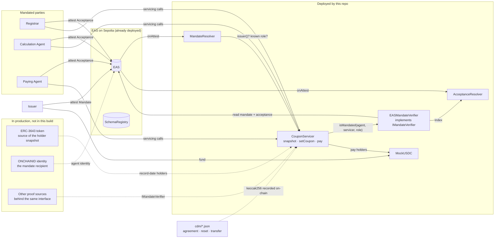
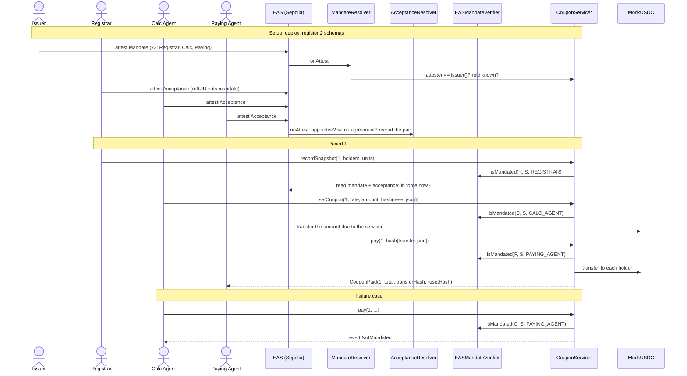

# Mandates for on-chain bond servicing

**Who may act on a tokenized bond, under which agreement, and until when, checked on-chain before every servicing step.**

This repo is the leave-behind for the talk *"Bridging on-chain and off-chain Finance: Integrating FINOS CDM with Smart Contracts"* (Open Source in Finance Forum, New York, 2026-11-05), by Tom Healey of FINXIS and Andrew Levy of OpenZeppelin, speaking for themselves. It is a working example on the Sepolia testnet: an issuer appoints a Registrar, a Calculation Agent and a Paying Agent; each one accepts; and a coupon gets paid, with every step gated by those mandates.

The CDM side of the talk is Tom Healey's [cdm-web3-plugin](https://github.com/finxisadmin/cdm-web3-plugin), which turns CDM objects into on-chain calls. This repo does not use it. It simulates the plugin's output with small hand-written CDM-shaped files in [`cdm/`](cdm/), and puts their hashes on-chain.

You can use it three ways:

1. **[Trace our demo](#1-trace-our-demo)**: every transaction and attestation, with links. No install needed.
2. **[Run it locally](#2-run-it-locally)**: tests and a full dry run on a local copy of Sepolia. No keys, no faucet.
3. **[Deploy your own](#3-deploy-your-own-on-sepolia)** on Sepolia, by following the steps or by handing [`AGENTS.md`](AGENTS.md) to a coding agent.

Get the code:

```sh
git clone https://github.com/amlevy327/osff-cdm-mandates-demo.git
cd osff-cdm-mandates-demo
```

> Proof of concept for a conference talk. Testnet only, not audited, not for production use. The cash token is a mock that anyone can mint. See [Disclaimer](#disclaimer).

---

## The idea

CDM models the agreement. The chain enforces the state. **Mandates connect the two.**

A servicing contract does not need to know how authority is proven. It asks one question, through one small interface:

```solidity
interface IMandateVerifier {
    /// True if `agent` holds an in-force, accepted mandate for `role` on `servicer`.
    function isMandated(address agent, address servicer, bytes32 role) external view returns (bool);
}
```

Anything that can answer that question can sit behind it. Here the answer comes from attestations on [EAS](https://attest.org) (Ethereum Attestation Service). Another deployment could answer from identity claims or a legal-entity credential. **The servicing contract does not change when the proof source does**, so there is no lock-in.

### Three layers of control

| Layer | Question | Usual tool |
|---|---|---|
| Permission | Who may call this function? | Access control (e.g. OpenZeppelin `AccessControl`) |
| Custody | How is the key protected? | Multisig, MPC, HSM |
| **Authority** | **Why may this party act, under which agreement, until when?** | **Mandates (attestations), this repo** |

Mandates add the third layer. They do not replace the other two. In this repo the contract admin keeps governance (it can swap the verifier) but **cannot service the bond itself**: admin rights are not a mandate.

### An alternative: OpenZeppelin AccessManager

Mandates could also plug into OpenZeppelin's standard permission hook instead of a custom modifier. A small adapter would implement `IAuthority.canCall(caller, target, selector)` by mapping the function to its role and asking `IMandateVerifier`. Any contract built on `AccessManaged` would then get mandate checks without code changes.

### What a mandate holds

| | In this repo |
|---|---|
| **Who** | The issuer appoints (the attester), the agent is appointed (the recipient), and the agent accepts with its own counter-attestation |
| **What** | A role (`REGISTRAR`, `CALC_AGENT`, `PAYING_AGENT`) on one servicing contract, for one asset (`ISIN:XS1234567890`) |
| **When** | Valid from a date, expires (EAS `expirationTime`), can be revoked by the issuer, or resigned by the agent |
| **Proof** | The hash of the agreement document (`cdm/paying-agency-agreement.json`) |

The verifier says yes only when **all** of these hold right now: the mandate exists, names this agent, this contract and this role, is in force (after `validFrom`, before expiry), is not revoked, and the agent's acceptance exists and is not revoked.

---

## 1. Trace our demo

Open **[TRACE.md](TRACE.md)**. It lists every contract, schema, mandate, acceptance and transaction from our run on 2026-10-31, each with an Etherscan or easscan link, including one transaction that **failed on purpose**: the Calculation Agent tried to pay the coupon and was refused with `NotMandated`.

To read the same facts straight from the chain (needs [Foundry](https://getfoundry.sh), no keys, no `.env`):

```sh
make install     # fetch the pinned dependencies
make trace       # contracts, mandate status now, coupon, and the CDM hash checks
make failures    # simulate four parties acting outside their mandate (nothing is sent)
```

`make trace` recomputes the hash of each sample CDM file in `cdm/` and checks it against the hash recorded on-chain.

## 2. Run it locally

Requires Foundry **1.8.7 or newer** (`foundryup`).

```sh
make install
make test        # 37 tests against a real EAS deployed in the test
make dry-run     # the whole demo, periods 1 and 2, on a local fork of Sepolia
```

`make dry-run` starts a local copy of Sepolia (with the real EAS on it), runs every step with a public test mnemonic, sends one real failed transaction, pays a second coupon period, then shuts down. Nothing is sent to Sepolia.

## 3. Deploy your own on Sepolia

1. **Create `.env`** from the template and fill it in:
   ```sh
   cp .env.example .env
   cast wallet new-mnemonic        # a NEW phrase, used only for this
   ```
   `.env` holds two values: `SEPOLIA_RPC_URL` (a full URL) and `MNEMONIC` (in quotes). Never commit it or paste it anywhere. All seven actors are derived from that one mnemonic.
2. **Check it**, without printing either secret:
   ```sh
   make check-env DEPLOYMENT=mine
   ```
3. **Fund the issuer** (mnemonic index 0) with about **0.1 Sepolia ETH** from a faucet. Get its address with `cast wallet address --mnemonic "<your phrase>"`, typed in your own terminal. Step 00 tops up the three agents from the issuer, so this is the only faucet trip.
4. **Run it:**
   ```sh
   make demo DEPLOYMENT=mine                  # deploy, appoint, accept, pay period 1, trace
   make fail-onchain DEPLOYMENT=mine          # one real failed tx: the Calc Agent calls pay()
   make coupon PERIOD=2 DEPLOYMENT=mine       # the next coupon, same mandates
   ```
   Addresses and schema ids land in `deployments/mine.json`. The default deployment name, `sepolia`, is ours: `make` refuses to overwrite it with a different issuer.

### The steps

Each step is a numbered script in `script/` and a `make` target of the same name, so you can run them one at a time.

| # | `make` | Signed by | What happens |
|---|---|---|---|
| 00 | `setup` | Issuer | Lists the actors and sends each agent 0.01 ETH for gas |
| 01 | `deploy` | Issuer | Deploys the five contracts and registers the two EAS schemas |
| 02 | `appoint` | Issuer | Attests three mandates (one per agent), each carrying the agreement hash |
| 03 | `accept` | Each agent | Each agent finds its pending mandate on-chain and counter-attests |
| 04 | `snapshot` | Registrar | Records the holders and their units at the record date |
| 05 | `set-coupon` | Calculation Agent | Records the rate, the amount per unit, and the hash of the CDM reset |
| 06 | `fund` | Issuer | Mints test cash and moves exactly the amount due into the servicer |
| 07 | `pay` | Paying Agent | The servicer pays every holder and records the hash of the CDM transfer |
| 08 | `failures` | nobody (simulated) | Four parties try to act outside their mandate |
| 09 | `trace` | nobody (read-only) | Links everything and checks the CDM hashes |

---

## How it works

### Architecture



### Sequence (period 1)



### The contracts

| Contract | Job |
|---|---|
| [`IMandateVerifier`](src/interfaces/IMandateVerifier.sol) | The one question. The only thing a servicing contract depends on |
| [`EASMandateVerifier`](src/mandates/EASMandateVerifier.sol) | Answers it from EAS. Re-checks everything live (revocation, `validFrom`, expiry, acceptance), because EAS's own `isAttestationValid` only checks that an attestation exists. Also offers `status()`, which says *why*: `Active`, `NoMandate`, `MandateRevoked`, `NotYetInForce`, `Expired`, `Resigned` |
| [`MandateResolver`](src/mandates/MandateResolver.sol) | Runs inside EAS when a mandate is attested. Rejects it unless the attester is the servicing contract's `issuer()`, the role is one that contract knows, the term makes sense, and it is revocable. Keeps `appointmentOf(agent, servicer, role)` so an agent can find its pending mandate |
| [`AcceptanceResolver`](src/mandates/AcceptanceResolver.sol) | Runs inside EAS when an acceptance is attested. Rejects it unless it points at a live mandate, comes from that mandate's appointee, and names the same agreement hash. Indexes mandate and acceptance for the verifier |
| [`CouponServicer`](src/CouponServicer.sol) | The bond's servicing contract. `recordSnapshot` needs `REGISTRAR`, `setCoupon` needs `CALC_AGENT`, `pay` needs `PAYING_AGENT`. Everything is keyed by coupon period, so period 2 onward uses the same code. The admin can only swap the verifier |
| [`MockUSDC`](src/MockUSDC.sol) | Test cash, 6 decimals, open mint. Testnet only |

### The two EAS schemas

| Schema | Fields | Attester → recipient |
|---|---|---|
| Mandate (revocable) | `string partyId, string assetId, address servicer, bytes32 role, uint64 validFrom, bytes32 agreementHash` | Issuer → agent |
| Acceptance (revocable) | `bytes32 agreementHash`, with `refUID` = the mandate | Agent → issuer |

Expiry and revocation use EAS's own fields. To resign, an agent revokes its acceptance. To replace an agent, the issuer revokes the old mandate and appoints a new one: the servicing contract does not change.

### How the coupon is paid

The servicer is **funded first**. In step 06 the issuer moves exactly the amount due into the CouponServicer. In step 07 the Paying Agent calls `pay`, and the contract pays each holder `units × amount per unit` from its own balance. The Paying Agent authorizes the payment but never holds the cash. If the contract is short, `pay` stops before moving anything, with `InsufficientCash(available, required)`.

This mirrors an issuer funding its paying agent before the payment date, and it means a payment cannot fail halfway through. Two alternatives were considered: pulling the cash from the issuer at payment time, or from the paying agent's own account.

### The CDM link

`cdm/` holds three small, illustrative files shaped like [FINOS CDM](https://www.finos.org/common-domain-model) objects: the paying-agency agreement, and per period a reset (the Calculation Agent's output) and a transfer (the Paying Agent's output). The chain stores the `keccak256` of each file's exact bytes: the agreement hash in every mandate, the reset hash in `setCoupon`, the transfer hash in `pay`. Anyone holding the files can check them against the chain, which is what `make trace` does.

These hashes are over raw file bytes, **not a canonical CDM serialization**. Two firms that serialize the same CDM object differently get different hashes. Canonical hashing is an open problem (see [what's not here](#whats-not-here)).

---

## Cost

Measured from real transactions. ETH = **$2,253.41** (CoinGecko, 2026-10-31). Mainnet gas price that day: **0.0292 gwei**.

**Under mainnet's current rules** (measured on a fork of Sepolia, which still runs mainnet's gas rules locally):

| What | Gas | Mainnet, 2026-10-31 | At 1 gwei | At 10 gwei |
|---|---|---|---|---|
| One-time setup (5 deploys + 2 schemas, 3 mandates, 3 acceptances, gas top-ups) | 6,853,220 | $0.45 | $15.44 | $154.43 |
| One coupon period (3 holders) | 786,519 to 854,931 | $0.05 to $0.06 | $1.77 to $1.93 | $17.72 to $19.27 |
| **Full demo** (setup + period 1 + the failed tx) | **7,741,293** | **$0.51** | **$17.44** | **$174.44** |
| Each extra holder, per period | 72,497 | <$0.01 | $0.16 | $1.63 |

**On Sepolia today:** Sepolia took a network upgrade on 2026-10-06 that charges much more for creating new state (new accounts, contracts, storage). The same demo used **42.7M gas, about 5.5× more** (setup 5.8×, a coupon period 3.0×). At the prices above that is $2.81, $96 at 1 gwei, $962 at 10 gwei. Mainnet had not taken this upgrade at the time of writing. If it does, expect deploys to cost roughly 5 to 6 times more and each period about 3 times more. Full table in [TRACE.md](TRACE.md#gas-on-sepolia-after-its-2026-10-06-upgrade).

On Sepolia none of this is real money: test ETH comes free from a faucet.

**Scaling:** cost grows by about 72.5k gas per holder per period (mainnet rules), and each transaction must fit in one block. One `recordSnapshot` tops out around 1,000 holders, one `pay` around 2,000. A real bond would batch, or let holders claim.

---

## Where ERC-3643 and ONCHAINID fit (explained, not built)

This build deliberately leaves both out, to keep the mandate idea visible. This is how they plug in.

**[ERC-3643](https://eips.ethereum.org/EIPS/eip-3643) (permissioned security token).** In production the bond itself would be an ERC-3643 token, and the record-date holder snapshot would come from its register. In this demo the Registrar enters the snapshot by hand. No standard defines that handoff today.

**ONCHAINID (on-chain identity), on its `develop` branch.** That version of ONCHAINID makes each identity an ERC-7579 modular smart account built on OpenZeppelin's account libraries, and can read EAS attestations live. In production the mandate's recipient would be the agent firm's identity rather than one key: keys can rotate behind the identity without re-attesting the mandate, and identity claims and mandates come from the same attestation system. One design point: the agent should call the servicing contract **as its identity**, so the mandate check and the identity are the same address. It is not on ONCHAINID's default branch yet.

---

## What's not here

Production gaps, in rough order of importance:

- **Succession without a gap.** Replacing an agent is revoke-then-appoint. Production needs a handover where the new mandate starts exactly when the old one ends.
- **Grace periods.** A lapsed mandate blocks a payment, and a late coupon can be a default. Production needs a policy for that.
- **Scale.** Batching or a claim model past about 1,000 holders (see [Cost](#cost)).
- **Canonical CDM hashing**, so independent firms produce the same hash for the same CDM object.
- **CDM gaps.** CDM has no field for a party's on-chain address, no `PayingAgent` role, no agreement end date, and no agency-agreement type. The demo fills these in by convention.
- **A CDM-to-chain bridge** that sends typed parameters, signs as each party with that party's own key, and reports a reverted transaction as a failure.
- **Amendments and joint mandates** (two parties that must both act).
- **Key custody.** The demo derives every actor from one mnemonic. Production keys live in an HSM or MPC wallet, one per firm.
- **Real cash and the token itself:** a regulated stablecoin or tokenized deposit instead of MockUSDC, and an ERC-3643 token as the register.
- **Audit.** None of this code has been audited.

---

## Repo layout

```
src/
  interfaces/IMandateVerifier.sol    the one question
  interfaces/IMandatedContract.sol   what a servicing contract exposes to the resolver
  mandates/                          EAS resolvers, schemas, and the EAS-backed verifier
  CouponServicer.sol  MockUSDC.sol
script/00_Setup … 09_Trace           one script per step (see the table above)
test/                                37 tests, against a real EAS deployed in the test
cdm/                                 sample CDM-shaped files whose hashes go on-chain
deployments/sepolia.json             our demo's addresses and schema ids
TRACE.md                             our demo, step by step, with links
AGENTS.md                            instructions for a coding agent
LICENSE                              MIT
```

## Notes

- **Tooling.** Built with Foundry 1.8.7, Solidity 0.8.29, OpenZeppelin Contracts 5.3.0, EAS contracts 1.9.0. Sepolia's 2026-10-06 upgrade is not modeled by Foundry's local simulation yet, so the broadcast steps use `--skip-simulation` and take their gas from the network. Because of that, `make dry-run` shows mainnet-rules gas, not Sepolia's.
- **EAS on Sepolia** is the canonical deployment: EAS `0xC2679fBD37d54388Ce493F1DB75320D236e1815e`, SchemaRegistry `0x0a7E2Ff54e76B8E6659aedc9103FB21c038050D0`. For another chain, set `EAS`, `SCHEMA_REGISTRY`, `EXPLORER_URL` and `EASSCAN_URL` in `.env`.
- **Secrets.** `make check-env` validates `.env` without printing it, and no `make` command echoes the RPC URL. Use a mnemonic made for this demo and nothing else.

## Disclaimer

Proof of concept only: not audited, not for production, provided as is under [`LICENSE`](LICENSE). This is a personal project, not a product of OpenZeppelin, FINXIS or FINOS, and is not endorsed or maintained by them. Company names only identify the speakers.

## License

MIT
